<div align="center">

<picture>
  <source media="(prefers-color-scheme: dark)" srcset="assets/readme/banner-oscuro.svg">
  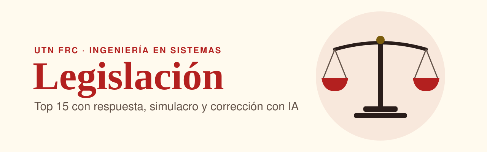
</picture>

<h1>Legislación · UTN FRC</h1>

<p><b>Para rendir Legislación: las preguntas más probables con respuesta modelo, simulacro de desarrollo y corrección con IA.</b></p>

<a href="https://gabibertero.github.io/legislacion/"></a>

        [](https://claude.com/claude-code)

[Inicio](https://gabibertero.github.io/legislacion/) · [1º parcial](https://gabibertero.github.io/legislacion/parcial-1/) · [2º parcial](https://gabibertero.github.io/legislacion/parcial-2/) · [Top 15](https://gabibertero.github.io/legislacion/parcial-2/top15/) · [Simulacro](https://gabibertero.github.io/legislacion/parcial-2/teoria/)

<br>

<picture>
  <source media="(prefers-color-scheme: dark)" srcset="assets/readme/mockup-oscuro.png">
  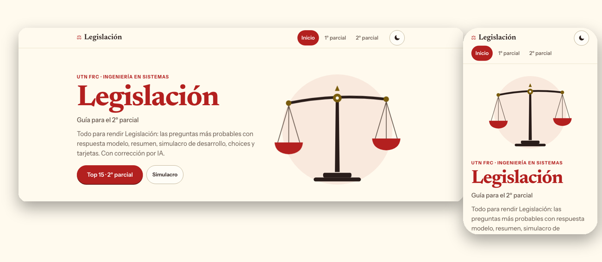
</picture>

</div>

<details>
<summary>📑 Contenido</summary>

- [Qué tiene](#qué-tiene)
- [Cómo usarlo](#cómo-usarlo)
- [Temas](#temas)
- [Cómo está hecho](#cómo-está-hecho)
- [Para desarrollar](#para-desarrollar)
- [Roadmap](#roadmap)
- [FAQ](#faq)
- [Hecho con Claude](#-hecho-con-claude)
- [Créditos y licencia](#créditos-y-licencia)

</details>

## Qué tiene

<table>
<tr><td valign="top" width="50%">⭐ <b>Top 15</b><br>Las 15 preguntas más probables, con respuesta modelo a la vista.</td><td valign="top" width="50%">⏱️ <b>Simulacro</b><br>5 preguntas al azar, cronómetro de 60 min.</td></tr>
<tr><td valign="top" width="50%">✨ <b>Corrección con IA</b><br>Un botón: Claude, ChatGPT, Gemini o copiar el prompt.</td><td valign="top" width="50%">📝 <b>Resumen y machete</b><br>9 temas de la U2 y una hoja para el último repaso.</td></tr>
<tr><td valign="top" width="50%">✅ <b>Choices</b><br>187 con explicación y "solo las que fallé".</td><td valign="top" width="50%">🃏 <b>Tarjetas</b><br>128 con repaso espaciado en 3 cajas.</td></tr>
</table>

Más: Home con cuenta regresiva, progreso por tema y "seguir donde dejaste"; tema claro/oscuro; 390 px sin scroll horizontal.

<details>
<summary>Top 15 con respuesta y "Explicámelo con IA"</summary>

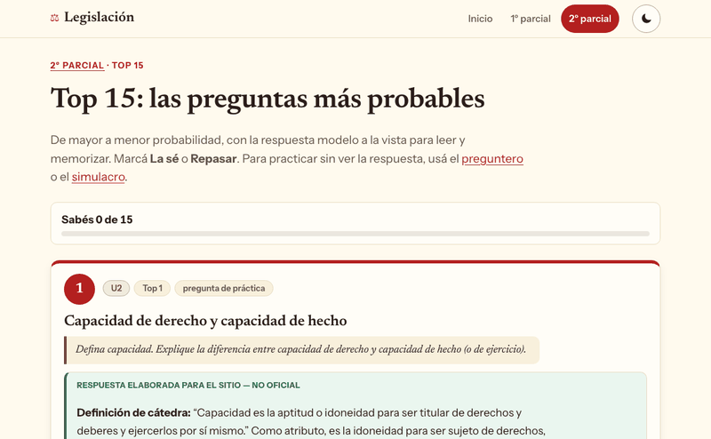

<picture>
  <source media="(prefers-color-scheme: dark)" srcset="assets/readme/top15-oscuro.png">
  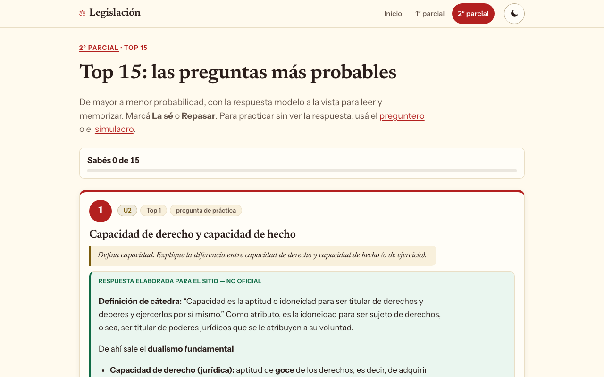
</picture>

</details>

<details>
<summary>Simulacro de desarrollo y corrección con IA</summary>

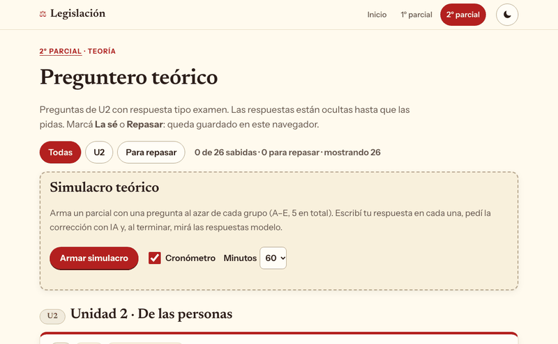

<picture>
  <source media="(prefers-color-scheme: dark)" srcset="assets/readme/simulacro-oscuro.png">
  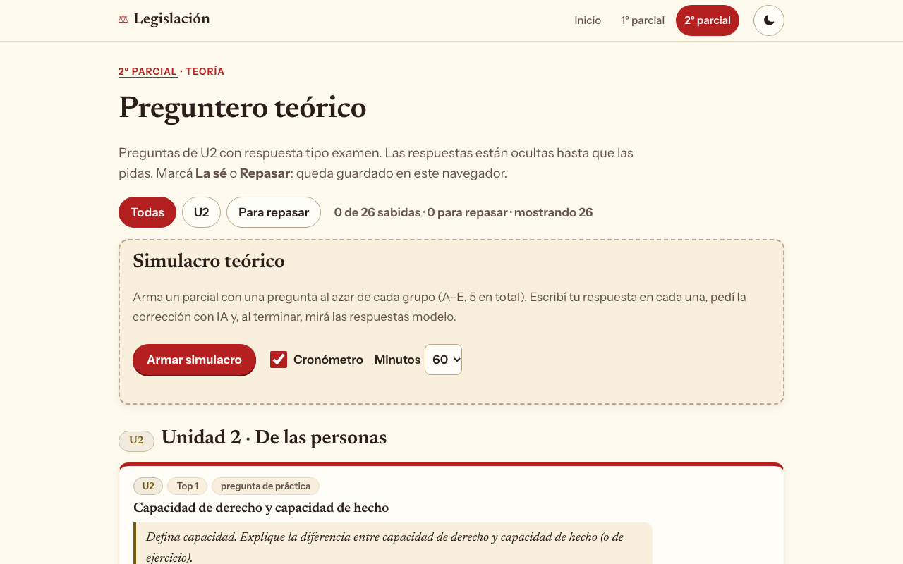
</picture>

</details>

<details>
<summary>Choices y tema claro/oscuro</summary>

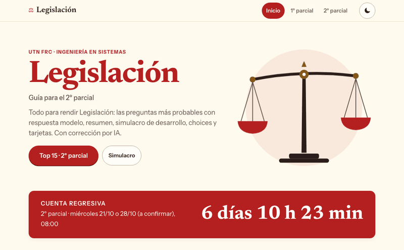

<picture>
  <source media="(prefers-color-scheme: dark)" srcset="assets/readme/choices-oscuro.png">
  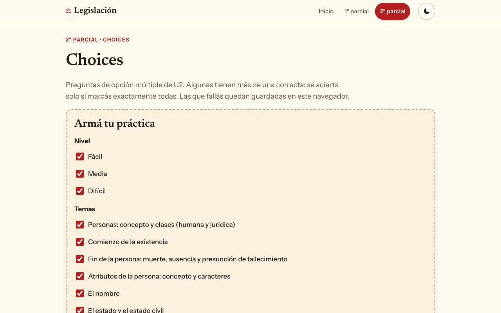
</picture>

</details>

<details>
<summary>📱 En el celular</summary>

<p align="center">
<picture>
  <source media="(prefers-color-scheme: dark)" srcset="assets/readme/home-oscuro-m.png">
  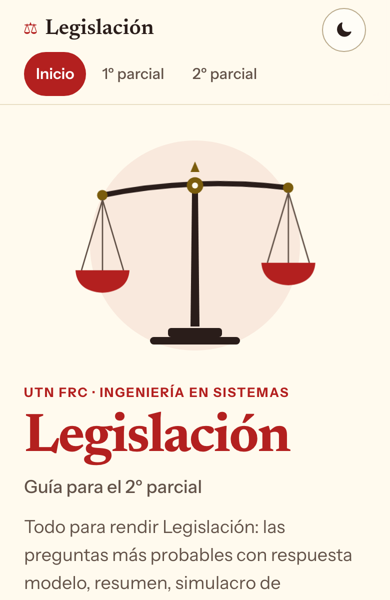
</picture>
<picture>
  <source media="(prefers-color-scheme: dark)" srcset="assets/readme/top15-oscuro-m.png">
  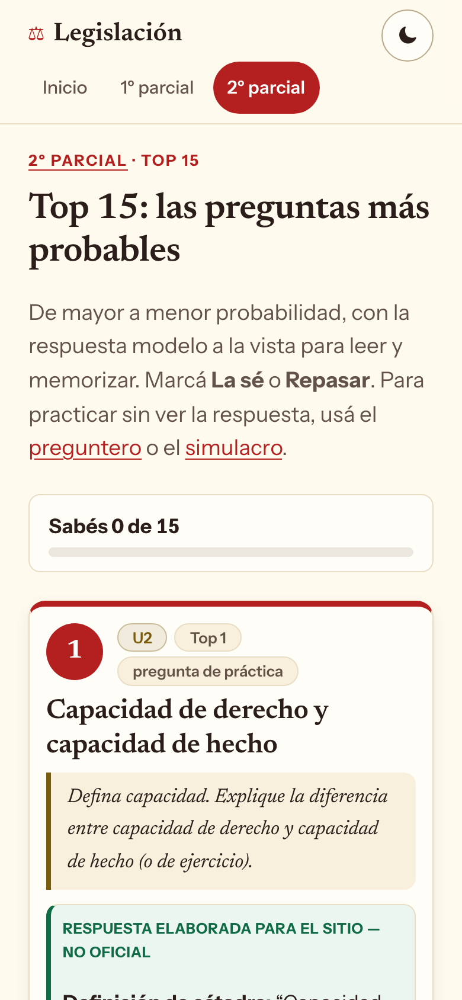
</picture>
</p>

</details>

## Cómo usarlo

El 2º parcial es de **desarrollo**: 4 o 5 preguntas, 60 min, y se responde con la definición de cátedra.

```text
1. Top 15           leelo de arriba hacia abajo, marcá "La sé" / "Repasar"
2. Resumen + machete  para ordenar los 9 temas
3. Choices y tarjetas  10 min por día, repaso espaciado
4. Simulacro         5 preguntas, 60 min, escribí tu respuesta
5. Corregir con IA   nota /10, qué falta y versión para el 10
```

> [!TIP]
> En el simulacro escribí la respuesta antes de mirar el modelo. Con "Corregir con IA" vacío, la IA te explica el tema.

> [!NOTE]
> Sitio **no oficial**. Las respuestas modelo se elaboran a partir de `Material_Legislacion`; el orden del Top 15 es una estimación. El progreso se guarda solo en tu navegador.

## Temas

| Unidad | Estado | Contenido |
|---|---|---|
| **U1** · El Derecho · Derecho Constitucional | 1º parcial (aprobado) | Parcial tomado resuelto (5 preguntas), 11 de desarrollo, resumen de 12 temas, 116 choices, 71 tarjetas |
| **U2** · De las personas | 2º parcial (21/10 o 28/10, a confirmar) | Top 15, 11 de práctica, simulacro, resumen de 9 temas + machete, 71 choices, 57 tarjetas |
| **U3** · Hechos jurídicos | Final | Próximamente |
| **U4** · Bienes y patrimonio | Final | Próximamente |

<details>
<summary>Los 9 temas de la U2</summary>

Personas (humana y jurídica) · Comienzo de la existencia · Fin de la persona · Atributos · Nombre · Estado y estado civil · Domicilio · Capacidad e incapacidad · Patrimonio.

</details>

## Cómo está hecho

    

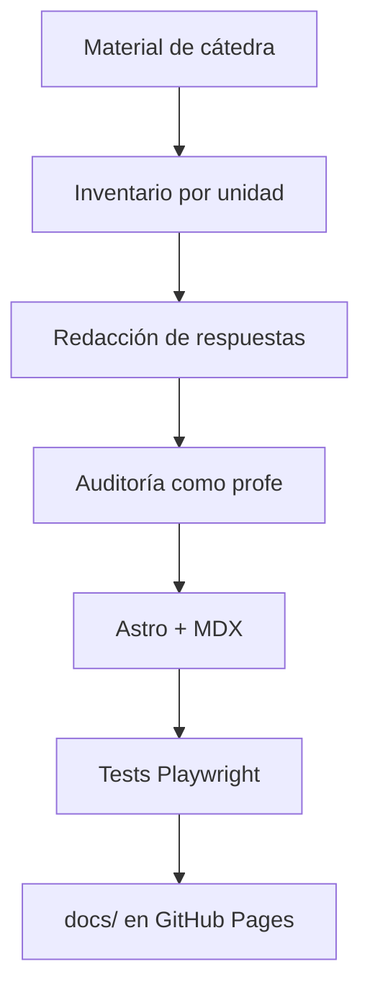

<details>
<summary>📁 Estructura</summary>

```text
.
├── fuente/                  # código (Astro)
│   ├── sitio.config.mjs     # único archivo específico de la materia
│   ├── src/content/         # preguntas y machetes (MDX)
│   ├── src/data/            # choices, tarjetas, temas (JSON)
│   ├── src/pages/           # Home y secciones por instancia
│   └── tests/               # Playwright + node --test
├── docs/                    # build publicado (no editar)
├── ESTADO-SITIO.md          # estado y decisiones
└── CHANGELOG.md
```

</details>

## Para desarrollar

Requisitos: Node 20 o superior.

```bash
cd fuente
npm install
npm run dev        # servidor local
npm run build      # genera ../docs
npm test           # Playwright (desktop + celular)
npm run test:lab   # node --test
```

**Agregar una pregunta:** editá `fuente/src/content/preguntas/u2.mdx` (un `<Pregunta>` con `tema`, `enunciado` y la respuesta), corré `npm run build` (valida ids) y `npm test`.

## Roadmap

- [x] 2º parcial · U2: Top 15, simulacro, resumen, machete, choices, tarjetas
- [x] Corrección con IA con un solo botón
- [x] 1º parcial · U1 migrada (la guía anterior sigue en `/u1/`)
- [x] Publicado en GitHub Pages (`main` · `/docs`)
- [ ] Confirmar la fecha del 2º parcial (21/10 o 28/10)
- [ ] Re-auditar el contenido migrado de la U1
- [ ] Final: U3 y U4

## FAQ

<details>
<summary>¿Es oficial?</summary>

No. Es un sitio de estudio personal armado con el material de cátedra.

</details>

<details>
<summary>¿Se guarda mi progreso?</summary>

Sí, en tu navegador (`localStorage`). No hay cuentas ni servidor: si borrás los datos del sitio, se pierde.

</details>

<details>
<summary>¿Encontré un error?</summary>

Abrí un [issue](https://github.com/gabibertero/legislacion/issues/new/choose) con la página y la pregunta. Ver [CONTRIBUTING](CONTRIBUTING.md).

</details>

## 🤖 Hecho con Claude

Este sitio lo construyó [Claude Code](https://claude.com/claude-code) con la skill `sitio-materia` y varios agentes, bajo la dirección de Gabi:

- **Entrevista** inicial: instancias, urgencia, qué entra y estética.
- **Contenido** con `inventariador` y `redactor`, y **auditoría** con `profe` (rúbricas y hallazgos aplicados).
- **Código** con `web`: Home, Top 15, simulacro, choices, tarjetas e IA.
- **Diseño** con `disenador`, auditado por `estetica`.
- **Calidad** con `tester` (82 E2E + 22 unitarios) y `code-reviewer`.
- **README** con `readme`.

Los commits llevan `Co-Authored-By: Claude`, por eso figura en Contributors. Revisión y criterio final: Gabi.

## Créditos y licencia

Material: cátedra de Legislación, UTN FRC. Licencia [MIT](LICENSE). Ver también [CHANGELOG](CHANGELOG.md).

<div align="center">

<sub>Made by Claudio 🧉 · Hecho con [Claude Code](https://claude.com/claude-code)</sub>

</div>
